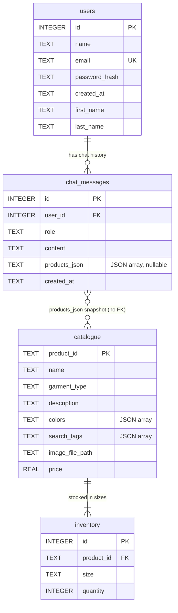

# Design

## 1. Database Documentation (Problem 2: Database Detective)

**Database:** `data/campus_customs.db` (SQLite 3, 168 KB, local only, git-ignored)
**Product images:** `data/products/*.jpg` (102 files, local only, git-ignored)
**Inspected:** 2026-10-20, read-only (`mode=ro`). The database was not modified.

### 1.1 Overview

| Table | Rows | Purpose |
|---|---:|---|
| `catalogue` | 102 | One row per product: name, type, description, colors, search tags, image path, price |
| `inventory` | 612 | Stock count for each product in each size (6 sizes × 102 products) |
| `users` | 3 | Customer accounts used for sign-in |
| `chat_messages` | 22 | Saved shopping-assistant conversation history, per user |

Database-level settings:

| Setting | Value | Meaning |
|---|---|---|
| `PRAGMA foreign_keys` | `0` (off) | SQLite does **not** enforce the declared foreign keys unless each connection turns this on |
| `PRAGMA foreign_key_check` | no violations | The current data has no broken references |
| `PRAGMA integrity_check` | `ok` | The file is not corrupted |
| `journal_mode` | `delete` | Default rollback journal (no WAL) |
| Indexes | auto-created only | For `catalogue.product_id`, `inventory(product_id, size)`, `users.email` |
| Views / triggers | none | |

### 1.2 Entity relationships



- **Product → inventory (one-to-many):** each `catalogue` product has exactly 6 `inventory` rows, one per size.
  `inventory.product_id` references `catalogue.product_id`.
- **User → chat messages (one-to-many):** `chat_messages.user_id` references `users.id`.
- **Chat messages → products (informal, no foreign key):** assistant messages store a JSON *copy* of the
  recommended products in `products_json`. This copy includes price and stock at the time of the chat.
  It is not a live link, so it can go out of date when the catalogue or inventory changes.
- **Users and products are not otherwise linked.** There are no orders, cart, or wishlist tables.

### 1.3 Table: `catalogue`

**Purpose:** the product catalogue, used for listing, search, product pages, and the AI assistant's product lookups.

| Column | SQLite type | Null? | Key / constraint | Notes |
|---|---|---|---|---|
| `product_id` | TEXT | no (implicitly) | **PRIMARY KEY** | URL-style slug, e.g. `basic-hoodie-big-yale`. Only lowercase letters, digits and hyphens |
| `name` | TEXT | NOT NULL | | Title-cased from the slug, e.g. "School Of Medicine 1 4 Zip". All unique |
| `garment_type` | TEXT | NOT NULL | | Free text with 22 inconsistent values (see 1.7) |
| `description` | TEXT | NOT NULL | | 93–184 characters, never empty |
| `colors` | TEXT | NOT NULL | | **JSON array stored as text**, e.g. `["navy", "white"]` |
| `search_tags` | TEXT | NOT NULL | | **JSON array stored as text**, 4–12 tags per product |
| `image_file_path` | TEXT | NOT NULL | | Relative to `data/`, e.g. `products/basic-hoodie-big-yale.jpg` |
| `price` | REAL | NOT NULL | | US dollars. Range $32–$98, average $58.48 |

Price points: $32 (25 products), $45 (5), $58 (28), $68 (23), $72 (11), $88 (2), $98 (8).

### 1.4 Table: `inventory`

**Purpose:** current stock for each product and size. This is the source of truth for "is this in stock in my size?"

| Column | SQLite type | Null? | Key / constraint | Notes |
|---|---|---|---|---|
| `id` | INTEGER | — | **PRIMARY KEY AUTOINCREMENT** | Surrogate key |
| `product_id` | TEXT | NOT NULL | **FOREIGN KEY** → `catalogue.product_id` | No `ON DELETE` / `ON UPDATE` action |
| `size` | TEXT | NOT NULL | `UNIQUE (product_id, size)` | Values: `XS`, `S`, `M`, `L`, `XL`, `XXL` |
| `quantity` | INTEGER | NOT NULL | | 0–25. No `CHECK (quantity >= 0)` constraint |

| Stock fact | Value |
|---|---|
| Total units in stock | 5,920 |
| Average units per size | 9.7 |
| Sizes with 0 units (sold out) | 145 of 612 (24%) |
| Sizes with 1–5 units (low stock) | 115 |
| Products sold out in **every** size | 0 |
| Products missing inventory rows | 0 |
| Inventory rows without a matching product | 0 |

### 1.5 Table: `users`

**Purpose:** customer accounts for sign-in. Chat history is saved per user.

| Column | SQLite type | Null? | Key / constraint | Notes |
|---|---|---|---|---|
| `id` | INTEGER | — | **PRIMARY KEY AUTOINCREMENT** | |
| `name` | TEXT | NOT NULL | | Full name. Currently always equals `first_name + " " + last_name` |
| `email` | TEXT | NOT NULL | **UNIQUE** | Uniqueness is case-sensitive in SQLite (see 1.7). One account uses a `campuscustoms.yale.edu` address, two use `yale.edu` |
| `password_hash` | TEXT | NOT NULL | | Format `pbkdf2_sha256$<salt>$<64-hex-char digest>` |
| `created_at` | TEXT | NOT NULL | DEFAULT `datetime('now')` | UTC text, `YYYY-MM-DD HH:MM:SS` |
| `first_name` | TEXT | **nullable** | | Added later with `ALTER TABLE`. Set for all 3 current users |
| `last_name` | TEXT | **nullable** | | Added later with `ALTER TABLE`. Set for all 3 current users |

Personal data (names, emails, hashes) is intentionally not reproduced in this document.

### 1.6 Table: `chat_messages`

**Purpose:** persistent chat history between each signed-in user and the AI shopping assistant.

| Column | SQLite type | Null? | Key / constraint | Notes |
|---|---|---|---|---|
| `id` | INTEGER | — | **PRIMARY KEY AUTOINCREMENT** | Increases in step with `created_at`, so it can be used for ordering |
| `user_id` | INTEGER | NOT NULL | **FOREIGN KEY** → `users.id` | No `ON DELETE` action |
| `role` | TEXT | NOT NULL | | `user` or `assistant`. No `CHECK` constraint |
| `content` | TEXT | NOT NULL | | The message text. Assistant replies use Markdown (`**bold**`, bullet lists) and Unicode punctuation (e.g. em dashes) |
| `products_json` | TEXT | nullable | | `NULL` for user messages. For assistant messages, a JSON array (`[]` if no products were shown) |
| `created_at` | TEXT | NOT NULL | DEFAULT `datetime('now')` | UTC text. All 22 messages are from 2026-09-19 |

| Chat fact | Value |
|---|---|
| Messages | 22 (11 user, 11 assistant, alternating) |
| Users with history | user 1 (6 messages), user 3 (16 messages). User 2 has none |
| Assistant messages with products | 5 (one with 1 product, four with 8 products) |
| Assistant messages with `[]` | 6 |
| Product IDs referenced in snapshots | 33, all still in `catalogue`. Saved prices still match current prices |

Each product object in `products_json` has these keys:

| Key | Matches DB? |
|---|---|
| `product_id`, `name`, `garment_type`, `description`, `image_file_path`, `price` | same as `catalogue` columns |
| `colors`, `search_tags` | parsed into real JSON arrays (not strings) |
| `image_url` | **not in DB**. A served URL such as `/media/products/<file>.jpg` |
| `inventory` | **not in DB**. List of `{size, quantity}` for all 6 sizes |
| `total_stock` | **not in DB**. Sum of the inventory quantities |

This shows the shape the earlier version of the app sent to the frontend: a product joined with its inventory,
plus an image URL served under `/media/`.

### 1.7 Observations that affect development

| # | Observation | Impact | Suggested handling (not implemented yet) |
|---|---|---|---|
| 1 | **Foreign keys are not enforced** (`PRAGMA foreign_keys = 0`) | Code could insert stock for a missing product or a message for a missing user without error | Run `PRAGMA foreign_keys = ON` on every connection |
| 2 | **`colors` and `search_tags` are JSON stored as TEXT** | Plain `LIKE` searches match brackets and quotes. Raw values look like `["navy"]` if shown directly | Parse with `json.loads` in Python, or use SQLite's `json_each()` for filtering |
| 3 | **`garment_type` is inconsistent** (22 values for about 7 real categories: "t-shirt", "short-sleeve t-shirt", "short-sleeve T-shirt", "crewneck", "crewneck sweatshirt", …) | Category filters and "show me hoodies" queries will miss products if they use exact matching | Map to normalized categories in code (T-shirt, Crewneck, Hoodie, Quarter-zip, Jacket/Fleece, Long-sleeve) and match case-insensitively. Leave the DB as is |
| 4 | **Color names are inconsistent** (22 values: "navy" vs "navy blue", "gray" vs "heather gray" vs "charcoal gray") | A search for "navy" must also find "navy blue" | Use substring or synonym matching for colors |
| 5 | **24% of size slots are sold out**, and many more are low stock | The UI and the assistant must not offer sold-out sizes as available | Always join `inventory`. Show per-size availability and disable sold-out sizes |
| 6 | **No orders, cart, or reservation tables** | Checkout can't be recorded, and nothing stops two shoppers buying the last unit | If a later problem needs a cart or orders, new tables or a transactional stock decrement will be needed |
| 7 | **No `CHECK` constraints** (`quantity >= 0`, `price > 0`, `role IN (...)`, `size IN (...)`) | Bad values are only caught by application code | Validate with Pydantic models in the backend |
| 8 | **Password hashes are `pbkdf2_sha256$salt$hexdigest` without an iteration count** | To check existing passwords, the backend must reproduce the original hashing exactly (iteration count, salt encoding). One user's salt is 15 non-hex characters; the other two are 16 hex characters | Need the original hashing parameters or the course's reference code. The plaintext passwords for the 3 accounts are also not known |
| 9 | **Email uniqueness is case-sensitive** | `Name@example.com` and `name@example.com` could become two accounts | Lowercase emails before saving and looking them up |
| 10 | **`first_name` / `last_name` are nullable, and `name` duplicates them** | The fields can drift apart for new users | Fill all three together on sign-up |
| 11 | **`products_json` is a snapshot** | Old chats show the price and stock from when the message was sent | When reloading history, either label it as past information or refresh it from `catalogue`/`inventory` by `product_id` |
| 12 | **Timestamps are UTC text without a timezone marker** | Times show 4–5 hours ahead for US Eastern users if displayed raw | Treat as UTC and convert in the frontend |
| 13 | **Image paths are relative to `data/`** and the old app served them at `/media/products/...` | The backend has to serve `data/products/` as static files. They cannot be committed to the frontend | Mount `data/products` as a static route (e.g. `/media/products`) in FastAPI |
| 14 | **Images are mostly square but not all** (10 of 102 are not square, sides range 450–900 px, 8–98 KB each) | Grid cards can look uneven | Use a fixed aspect-ratio container with `object-fit: contain` |
| 15 | **Product names are mechanically title-cased** ("1 4 Zip" means "1/4 Zip", "Vs") | Names look slightly unpolished | Optional display clean-up in the frontend only |
| 16 | **The database holds personal data** (names, emails, password hashes) | It must never be published | Already covered by the `data/` and `*.db` rules in `.gitignore` |

### 1.8 How the pieces fit together

1. **Browsing:** the site lists products from `catalogue`, shows images from `data/products/` using
   `image_file_path`, and shows per-size availability from `inventory` (joined on `product_id`).
2. **Signing in:** a shopper signs in with a `users` row (email plus password checked against `password_hash`).
3. **Chatting:** each question and answer is saved to `chat_messages` under that user's `id`. When the assistant
   recommends products, it looks them up in `catalogue` + `inventory` and saves a copy in `products_json`, so the
   product cards can be shown again when the history is reloaded.

---

## 2. Application Architecture (Problem 3: Building the Campus Customs Website)

### 2.1 Overview

```text
Browser ──► Vite dev server :5173 (React + TypeScript)
               │  /api/*    proxied ─┐
               │  /media/*  proxied ─┤
                                     ▼
                         FastAPI (uvicorn) :8000
                           ├─ /api/products, /api/products/{id}, /api/filters, /api/health
                           └─ /media/products/<file>.jpg  ◄── hw4/data/products/ (static files)
                                     │
                                     ▼
                         hw4/data/campus_customs.db (SQLite, opened read-only for catalogue reads)
```

- The frontend **never touches SQLite**. Everything comes from the FastAPI JSON API.
- In development, Vite proxies `/api` and `/media` to the backend, so the frontend uses relative URLs
  (`/api/products`) and needs no hard-coded backend address or CORS setup. CORS is also enabled for
  `localhost:5173` in case the API is called directly.
- Product images are **not copied** into the frontend. The backend serves them straight from `data/products/`,
  which stays git-ignored.

### 2.2 Backend (`backend/`)

| File | Responsibility |
|---|---|
| `config.py` | Paths (`DATA_DIR`, `DB_PATH`, `PRODUCTS_DIR`), loads `hw4/.env`, allowed frontend origins |
| `db.py` | The single `connect()` helper: opens the existing DB file only (never creates one), turns on `PRAGMA foreign_keys`, uses named-column rows, commits or rolls back. `readonly=True` opens with `mode=ro` |
| `catalogue.py` | Catalogue and inventory queries plus normalization (categories, color groups, display names, stock status). Reusable by the agent tools later |
| `models.py` | Pydantic response models (`ProductSummary`, `ProductDetail`, `SizeStock`, `CatalogueFilters`, …) shared by the API and later the agent |
| `main.py` | FastAPI app: routes, input validation, static image mount, error handlers |
| `agent.py`, `tools.py`, `prompts/prompt.md` | Still placeholders. Reserved for the AI assistant in later problems |

**Endpoints**

| Method & path | Purpose | Validation / errors |
|---|---|---|
| `GET /api/products` | List products with per-size inventory | `category` and `color` must be known slugs (else 422); `q` ≤ 100 chars; `in_stock` boolean; `sort` ∈ `name`, `price_asc`, `price_desc` |
| `GET /api/products/{product_id}` | One product with description, tags, colors and sizes | `product_id` must match `^[a-z0-9-]+$` (else 422); unknown id → 404 `Product not found.` |
| `GET /api/filters` | Category and color-group options with counts, price range, total products | — |
| `GET /api/health` | Health check | — |
| `GET /media/products/<file>` | Product image | Served by `StaticFiles`; path traversal outside `data/products` → 404 |

A missing database file returns **503** with a clear message instead of crashing or creating an empty DB.

**SQL safety:** every value from a request is passed as a `?` parameter (`WHERE product_id = ?`, `LIKE ?`).
No user input is formatted into SQL strings.

### 2.3 Handling inconsistent data (without changing the database)

The original values are always returned unchanged. Derived fields are added next to them:

| Derived field | Rule | Result |
|---|---|---|
| `category` | Keyword rules on `garment_type`, most specific first: quarter-zip → hoodie/hooded → jacket/fleece → crewneck/mockneck/sweatshirt → long-sleeve → t-shirt | 22 raw labels → 6 categories: Crewnecks & Sweatshirts (29), Hoodies (27), T-Shirts (25), Quarter-Zips (11), Jackets & Fleece (8), Long Sleeve (2). No product falls into "Other" |
| `color_families` / `color_details` | Keyword rules on each color name (navy before blue; gray/grey/charcoal → Gray; cream/ivory → White & Cream; coral → Red & Coral; gold → Yellow & Gold) | 22 raw color names → 9 filterable color groups |
| `display_name` | Display-only punctuation fixes: `1 4 Zip` → `1/4 Zip`, `T Shirt` → `T-Shirt`, `Vs` → `vs.` | `name` keeps the exact DB value |
| `sizes[].status` | `0` → `sold_out`, `1–5` → `low_stock`, `6+` → `in_stock` (`LOW_STOCK_MAX = 5`) | Quantities come straight from `inventory` |
| `total_stock`, `in_stock` | Sum of the product's inventory quantities; `in_stock` = total > 0 | — |

### 2.4 Frontend (`frontend/`)

| Path | Responsibility |
|---|---|
| `src/main.tsx`, `src/App.tsx` | Entry point and routes (React Router): `/`, `/shop`, `/products/:productId`, `*` (404) |
| `src/api.ts`, `src/types.ts` | Typed API client (mirrors `backend/models.py`); friendly error messages |
| `src/hooks/useApi.ts` | Data-loading hook with loading/error state and request cancellation |
| `src/components/Layout.tsx` | Header, page outlet, footer, and the chat widget (mounted once, so the conversation survives navigation) |
| `src/components/Header.tsx` | Sticky header, announcement bar, category navigation, mobile hamburger menu |
| `src/components/ProductCard.tsx` | Card: image, category, name, price, "N of 6 sizes available", "Sold out" badge |
| `src/components/ChatWidget.tsx` | Floating chat launcher and panel (see 2.6) |
| `src/components/Hero.tsx`, `Logo.tsx` | Branding components with image slots for the Handsome Dan assets |
| `src/pages/HomePage.tsx` | Hero, shop-by-category tiles (real counts and images), featured products, store highlights |
| `src/pages/CataloguePage.tsx` | All products, with search, category/color filters, "hide sold-out" and sort. Filter state lives in the URL (`/shop?category=hoodies&color=navy`), so it can be shared and bookmarked |
| `src/pages/ProductPage.tsx` | Breadcrumbs, large image, price, description, size picker with real per-size stock (sold-out sizes disabled), style/colors/total stock/tags, related products |
| `src/brand/brand.ts` | Store name, tagline, assistant name, and `mascot` image slots |
| `src/styles/theme.css` | Design tokens: Yale Blue `#00356B`, neutrals, status colors, fonts, radii, shadows |
| `src/styles/app.css` | Layout and component styles, responsive breakpoints at 900 / 760 / 520 px |

**Visual design:** Yale Blue with white and cool-gray neutrals; serif display headings (Palatino-style) with a
system sans-serif body. This follows the Problem 3 request rather than the workspace's black-and-pink default.
Accessibility features: skip link, visible focus rings, `aria-pressed` filter chips, labeled inputs,
`aria-live` loading and chat regions, and reduced-motion support.

### 2.5 Branding hooks for the Handsome Dan assets

- Drop files in `frontend/src/assets/brand/` and set the slots in `src/brand/brand.ts`:
  `mascot.hero` (homepage hero art), `mascot.chatAvatar` (chat header, launcher and message avatars),
  `mascot.logoMark` (header and footer logo).
  Until then, components show text/CSS placeholders ("CC" monogram, "Y" crest).
- Colors, fonts and shadows are all CSS variables in `theme.css`, so re-theming touches one file.
- Animations can be added per component. A `prefers-reduced-motion` rule is already in place.

### 2.6 Chat widget (UI only)

- A floating launcher (bottom-right) opens a panel with a header, conversation log, input and send button.
- A fixed welcome message introduces the Campus Customs Assistant.
- Shopper messages are right-aligned Yale-blue bubbles. Assistant messages are left-aligned white bubbles with an avatar.
- **No AI is connected and no replies are generated.** Sent messages are only added to the on-screen log, and a
  notice says the assistant isn't connected yet. The hand-off point is marked in `ChatWidget.tsx` (`send()`).
- Messages exist only in browser memory. Nothing is saved to `chat_messages` yet.
- Enter sends, Shift+Enter adds a new line, Escape closes. Messages are limited to 1,000 characters.

### 2.7 Decisions that affect later problems

| Decision | Why | Later impact |
|---|---|---|
| `db.connect()` is the only way into SQLite, with foreign keys enforced | One place for connection rules | Auth and chat-history writes can use `connect()` (read-write by default) |
| Catalogue logic lives in `catalogue.py`, not in route handlers | Lets the API and the agent share it | `tools.py` can call `catalogue.list_products(search=…)` / `get_product()` directly |
| Pydantic models in `models.py` | One schema for API and agent output | The assistant can return the same `ProductSummary` objects the cards already render |
| The API `products_json` shape is close to the old chat snapshots | Old snapshots have `product_id`, `price`, `image_url`, `inventory`, `total_stock` | Rendering saved chat products will need only a small adapter (`inventory` → `sizes`) |
| Images served at `/media/products/…` | Same path the earlier app used in saved chats | Old `image_url` values in `chat_messages` work unchanged |
| The backend runs without auto-reload | Avoids orphan server processes (workspace rule) | Restart the backend after Python changes |
| No cart or checkout. "Add to bag" is shown disabled with a note | Not requested, and there are no order tables | Would need new tables if a later problem asks for it |
---

## 3. Customer Accounts (Problem 4)

Full details are in [`harness.md`](harness.md), section 1. Summary of what changed in the architecture:

| Area | Addition |
|---|---|
| Backend files | `auth.py` (PBKDF2 hashing and signed session cookies), `users.py` (queries on the `users` table) |
| Backend endpoints | `POST /api/auth/register`, `POST /api/auth/login`, `POST /api/auth/logout`, `GET /api/auth/me` |
| Error format | Every error now returns `{ "detail": "<plain-English message>", "fields": { ... } }`. Validation, database-unavailable and unexpected errors all have friendly handlers, and tracebacks go to the server log only |
| Config / `.env` | `SESSION_SECRET` (signs cookies), `COOKIE_SECURE` (HTTPS only), optional `TEST_ACCOUNT_EMAIL` / `TEST_ACCOUNT_PASSWORD` for local tests |
| Frontend | `auth/AuthContext.tsx` (signed-in state for the whole app), `components/FormField.tsx` (labeled input with error and Show/Hide), pages `/account/login`, `/account/register`, `/account` |
| Header | Sign-in / "Hi, <name>" account button, visible on desktop and mobile |
| Database | **No schema change.** Accounts use the existing `users` columns, and sessions use a signed cookie instead of a new table |

**Decisions that affect later problems**
- `main.current_user(request)` returns the signed-in `UserPublic` or `None`. Later endpoints (chat history,
  personalized assistant) can call it to find out who is chatting and save `chat_messages` under that `user_id`.
- `users.create_user()` and `db.connect()` write in a transaction with foreign keys enforced, so future inserts
  into `chat_messages` will fail on an invalid `user_id` rather than store orphaned rows.
- The CORS settings now allow `POST` with credentials from the dev frontend, for future chat endpoints.
---

## 4. AI Shopping Assistant (Problem 5)

Full details are in [`harness.md`](harness.md), section 2. Architecture changes:

| Area | Addition |
|---|---|
| `backend/prompts/prompt.md` | System prompt: personality, the facts it may state, what it must not invent, scope, confidentiality |
| `backend/agent.py` | `shopping_agent` (PydanticAI `Agent`, `output_type=str`, `deps_type=AgentDeps`). Portkey-routed `OpenAIResponsesModel` created on first use. `reply()` maps errors to `AssistantUnavailable` and handles the provider content filter |
| `backend/tools.py` | `TOOLS = []`, registered with the agent. Problem 6 adds database tools here |
| `backend/models.py` | `ChatTurn`, `ChatRequest`, `ChatResponse`, `ProductCard` (reserved), `AgentDeps` |
| `backend/config.py` | `OPENAI_MODEL`, `PORTKEY_BASE_URL`, `PORTKEY_PROVIDER`, `PROMPT_PATH`, `portkey_api_key()` |
| `backend/main.py` | `POST /api/chat` (async). The friendly error map now covers chat fields |
| Frontend | `ChatWidget.tsx` connected to `/api/chat`: typing indicator, Try again, New chat, timeout. `ChatMarkdown.tsx` for safe rendering of replies |
| Run command | From `backend/`: `uvicorn main:app --reload --port 8000`. Imports within `backend/` are flat (`import catalogue`), so this works without `--app-dir` |
| Database | No change. Chat is not saved yet |
---

## 5. Product and Inventory Tools (Problem 6)

Full details and verification are in [`harness.md`](harness.md), section 3.

| Area | Change |
|---|---|
| `backend/tools.py` | `search_products` (catalogue) and `check_inventory` (inventory), async PydanticAI tools taking `RunContext[AgentDeps]`, listed in `TOOLS` |
| `backend/catalogue.py` | Added `search_products()` (natural-language ranking with category, color and price filters), `all_product_details()`, `size_from_text()`, `category_from_text()`, `color_from_text()`, and the `CATEGORY_SYNONYMS` / `COLOR_SYNONYMS` / `SIZE_ALIASES` tables. Existing functions unchanged |
| `backend/models.py` | Added `ProductInfo`, `ProductSearchResult`, `SizeAvailability`, `InventoryResult` |
| `backend/agent.py` | Usage limit raised to 8 requests / 12 tool calls per message |
| `backend/main.py` | Console logging for `campus_customs.*` loggers, so tool calls show in the server output |
| `backend/prompts/prompt.md` | Tool-use rules, answering rules, checkout note, and the unsupported affiliation and design claims removed |
| `frontend/src/components/Footer.tsx` | Removed the unsupported "Not affiliated with Yale University" claim |
| Database | No change. Tools open it read-only |

**For Problem 7 (product cards):** the tools already return `product_id`, name, price and page path. The backend
can collect the products returned by `search_products` / `check_inventory` during a run (e.g. into `AgentDeps`) and
turn them into `ChatResponse.products`, so cards always come from database rows, never from model text.
---

## 6. Product Cards in the Chat (Problem 7)

Full details are in [`harness.md`](harness.md), section 4.

| Area | Change |
|---|---|
| `backend/models.py` | `AgentReply` (agent output: `message`, `product_ids`, `size`). `ProductCard` expanded (category, colors, available sizes, requested-size stock). `ChatTurn.product_ids`. `AgentDeps.seen_product_ids`. `CHAT_CARDS_MAX = 6` |
| `backend/agent.py` | `output_type=AgentReply`. `build_cards()` verifies ids (seen in a tool result **and** in the catalogue) and builds cards only from database records, with size filtering. `_to_history()` adds notes about earlier cards. `reply()` returns a `ChatResponse` |
| `backend/tools.py` | `check_inventory` now takes `product_ids: list[str]` (batch). Both tools record returned ids in `deps.seen_product_ids`. The single-product logic moved to `inventory_for()` |
| `backend/main.py` | `/api/chat` returns the agent's `ChatResponse` (reply + cards) |
| `backend/prompts/prompt.md` | New "Product cards" section; updated tool flows |
| `frontend/src/components/ChatProductCards.tsx` | New: swipeable card row of router links |
| `frontend/src/components/ChatWidget.tsx` | Stores and renders cards, sends `product_ids` in the history, closes on phones when a card is opened |
| `frontend/src/types.ts`, `styles/app.css` | Card types and styles |
| Database | No change. Read-only |
---

## 7. Customer Memory and Page Context (Problem 8)

Full details are in [`harness.md`](harness.md), section 5.

| Area | Change |
|---|---|
| `backend/chat_history.py` (new) | `save_exchange()` (one transaction per question and answer), `context_turns()` (newest 20 saved messages for the model), `history_page()` (paged history), `products_json` parsing that tolerates both the new and the seeded format |
| `backend/main.py` | `POST /api/chat`: identity from the cookie; signed in → context from the database, the exchange saved; signed out → browser history, nothing saved; page context verified. New `GET /api/chat/history` (own messages only, paged, cards rebuilt fresh) |
| `backend/agent.py` | `describe_page()` (verified page and product context), richer `customer_context` instructions (memory scope, current page, "this" = the page product), `card_from_product()`, `restored_cards()` |
| `backend/models.py` | `PageContext`, `ChatRequest.page`, `ChatResponse.saved` / `user_message_id` / `message_id`, `SavedMessage`, `ChatHistory`, new `AgentDeps` fields for page and memory |
| `backend/prompts/prompt.md` | "Memory and the current page" section |
| `frontend/src/components/ChatWidget.tsx` | Restores history for signed-in customers, resets on account change, sends page context, New chat as a view boundary with "Show earlier messages", jumps to the newest message |
| `frontend/src/api.ts`, `types.ts`, `styles/app.css` | `fetchChatHistory`, history and page types, divider and "Show earlier" styles |
| Database | **No schema change.** Uses the existing `chat_messages` columns. One continuous thread per customer, because there is no conversation column |
### 7.1 Follow-up: separate conversations

Details are in [`harness.md`](harness.md), section 5.10.

| Area | Change |
|---|---|
| **Database** | **One small schema change:** `chat_messages.conversation_id INTEGER` (= id of the conversation's first message) and the index `idx_chat_messages_user_conversation (user_id, conversation_id, id)`. Applied by `chat_history.ensure_schema()` at startup after a full backup. Existing messages became one conversation per customer. Nothing deleted |
| `backend/chat_history.py` | `ensure_schema()`, `owns_conversation()`, `list_conversations()`, `latest_conversation_id()`. `save_exchange()` takes a `conversation_id` (null starts one). `context_turns()` and `history_page()` are scoped to one conversation |
| `backend/main.py` | Startup lifespan runs the migration. `POST /api/chat` takes and returns `conversation_id` (ownership-checked; null = new, no context). New `GET /api/chat/conversations`. `GET /api/chat/history?conversation_id=` (default: most recent; someone else's → 404) |
| `backend/models.py` | `ChatRequest.conversation_id`, `ChatResponse.conversation_id`, `ChatHistory.conversation_id`, `ConversationSummary`, `ConversationList`, `AgentDeps.new_conversation` |
| `backend/agent.py`, `prompts/prompt.md` | Memory wording is per conversation. New conversations start fresh. Older chats are reopened from the **Chats** button |
| `frontend/.../ChatWidget.tsx` | **Chats** list (title, time, count, Open badge, + New chat). New chat = new conversation. The most recent conversation opens on sign-in. No browser-stored conversation state |
| `frontend/src/api.ts`, `types.ts`, `styles/app.css` | `fetchConversations`, conversation-aware `fetchChatHistory`, conversation types and list styles |
---

## 8. Usability and Performance (Problem 9)

Details are in [`usability.md`](usability.md) and [`harness.md`](harness.md), section 6.

| Area | Change |
|---|---|
| `backend/smalltalk.py` (new) | `is_small_talk()`: strict greeting/thanks/goodbye detector, used by the agent and by conversation titles |
| `backend/tools.py` | Tools wrapped as `Tool(…, prepare=_hide_for_small_talk)`; `_report()` progress events; `check_inventory` can search by description; empty-search guard; per-tool timing in logs |
| `backend/agent.py` | Sets `deps.small_talk`; small-talk instruction; "Thinking…" progress; per-request (25 s) and total (50 s) timeouts; usage logging; measurement-only `PORTKEY_FORCE_REFRESH` and `OPENAI_REASONING_EFFORT` |
| `backend/main.py` | `_prepare_chat()` / `_run_chat()` shared by `POST /api/chat` and the new `POST /api/chat/stream` (NDJSON status + result) |
| `backend/models.py` | `AgentDeps.small_talk`, `AgentDeps.progress` (callable, excluded from serialization); `ConversationSummary.topics`, `.preview` |
| `backend/chat_history.py` | `list_conversations()` builds smarter titles, topics and previews; limit 200 |
| `backend/prompts/prompt.md` | One-step `check_inventory` flows; "fewest tool calls" guidance |
| `frontend/src/api.ts` | `sendChatStream()` (reads NDJSON from a fetch stream) and the shared `errorFrom()` |
| `frontend/.../ChatWidget.tsx` | Live status in the typing bubble and header (0.7 s minimum per message; reply never delayed); "Still working" after 8 s; Chats list with date groups, topic tags, previews and search |
| `frontend/src/styles/app.css` | Progress and list styles. Panel and status animations no longer start transparent. Shorter chat header status on phones |
| Database | **No change** in Problem 9 |
---

## 9. Visual Design and Handsome Dan (Problem 10)

### 9.1 Design direction

Campus Customs keeps its Yale-store look: Yale Blue (`#00356B`), white surfaces, a serif display face and clean
product grids. Problem 10 adds personality without changing that direction. **Handsome Dan**, the bulldog artwork
from the earlier AI Foundations assignment, becomes the face of the shopping assistant. He also appears in a few
places around the store. Product photos stay the main content: Dan never sits inside the product grid or on a product photo.

Three tokens were added in `styles/theme.css`, all taken from Dan's sheet: `--dan-cream` (#F6EFE4), `--dan-cream-deep`
and `--dan-gold`. The cream is the background colour of every pose, so it is used as the "frame" wherever Dan appears.

(The workspace-wide default is a black-and-pink style. This project has used Yale Blue since Problem 3 because it is
Yale-inspired, and Problem 10 asked to keep the design direction.)

### 9.2 Assets used

The originals in `hw3/branding/` are unchanged. The site uses WebP copies in `frontend/src/assets/brand/dan/`, imported
through `src/brand/dan.ts` so Vite fingerprints and caches them.

| Asset | Native size | Where it's used |
|---|---|---|
| Sitting pose | 327×420 | Homepage hero (cream arch), chat welcome (medallion), sign-in/register side panel |
| Neutral pose | 397×438 | Chat "thinking" state (small medallion) |
| Sniffing pose | 527×360 | Empty search results, 404 page; reduced-motion/fallback still for the sniff-walk |
| Fetching pose | 387×378 | Account page "Keep shopping" panel; reduced-motion/fallback still for the run |
| Cookie pop-up pose | 430×337 | "Fetched N styles for you" celebration in the chat |
| Sniff-walk strip (6 frames) | 6 × 344×168 | Chat: a search or stock check is running |
| Run strip (6 frames) | 6 × 339×168 | Chat: results are back and the reply is being prepared |
| Dan avatar (head) | small | Chat header, reply avatars, launcher button, product-page ask button |
| Paw print | small | Hero caption, homepage value card, footer legal line |
| Y crest, Y cookie | small | Homepage value-card icons (cookie cropped to a circle) |

**Not used, and why**

| Asset | Reason |
|---|---|
| "Found it" pose | Same moment as the cookie pop-up, which reads better as a reward. It is imported but never placed, so the browser never downloads it. |
| Individual animation frames | The 6-frame strips hold the same frames in one file (one request instead of six). |
| PNG strips and PNG poses | The WebP versions are much smaller with no visible difference. |
| Experimental `rig/`, `archive/` vector sheet, HTML animation previews | Prototypes, not finished art (as requested). |
| Full `bulldog_intelligence_sheet.png` and the reference sheet | Very large, and the text is baked into the image. |
| Instructor's `HandsomeDan` SVG/TSX files in other folders | Not our assets; Dan stays one consistent character. |

### 9.3 Handling the cream backgrounds

The poses have a solid cream background, and Dan's light fur is too close to that cream to cut out cleanly. Instead
of cutting them out, every pose sits on a matching cream shape so no rectangle ever shows:

- **Medallion**: a cream circle with a thin gold ring (`DanMedallion`). Used in the chat and on the auth pages.
- **Arch**: a tall cream arch with a gold ring for the hero, on Yale Blue.
- **Cream panels and notices**: the empty-search state, the 404 page and the account side panel use a cream card.

Only the paw print and crest were transparent enough to recolour (`paw-icon--light` turns the paw white on blue).
Poses are never shown larger than their native size (`DanPoseImage` caps the height), so they never blur.

### 9.4 Placements

| Place | What Dan does |
|---|---|
| Homepage hero | Sitting Dan in a cream arch beside the headline; caption with a paw: "Handsome Dan can help you find your fit." On phones the arch shrinks to 104×128 and sits in a row with the caption. |
| Homepage value cards | Crest, paw and cookie icons. The third card has an "Ask Handsome Dan" button that opens the chat. |
| Chat launcher | Avatar plus "Ask Handsome Dan". |
| Chat panel | Avatar and "Handsome Dan / Shopping assistant" in the header; sitting-Dan welcome on a new conversation; Dan's head beside his replies; animated working state; cookie celebration. |
| Product page | "Ask Handsome Dan about this item" opens the chat with a drafted question ("Is this available in size L?" when a size is selected). Nothing is sent until the shopper presses Send. "Add to bag" stays disabled with "Online checkout isn't available yet." |
| Empty search results, 404 | Sniffing Dan: "Dan sniffed around but couldn't find a match…" |
| Sign in / register | Sitting Dan medallion in the side panel. |
| Account page | Fetching Dan in a cream "Keep shopping" panel with Browse and Ask buttons. |
| Footer | Help text names Handsome Dan; paw icon on the legal line. |

The chat can be opened from anywhere through a small browser event (`src/chatEvents.ts`: `openChat(draft?)`). A draft
is only filled in if the shopper hasn't already typed something.

The assistant's prompt (`backend/prompts/prompt.md`) gained one paragraph: on the site the assistant appears as
Handsome Dan and may introduce itself that way. It must say plainly that it is an AI, and must not claim to be a real
dog or Yale's live mascot. This is the only backend change in Problem 10.

### 9.5 How the chat animations follow real activity

Dan's animation is driven only by the **status events the backend already streams** (Problem 9, `/api/chat/stream`).
Those events are emitted when a tool actually starts or finishes. Nothing is timed or faked on the frontend.

| Backend event (`stage`) | When it happens | Dan |
|---|---|---|
| none yet / `thinking` | Request sent; the model is deciding or writing (no tool running) | Neutral Dan, standing still in a small medallion |
| `searching` | `search_products` is running | **Sniff-walk** animation |
| `inventory` | `check_inventory` is running | **Sniff-walk** animation |
| `reviewing` | A tool has finished; the reply is being written from its results | **Run** animation ("fetching") |
| Reply received **with product cards** | Live reply that includes at least one verified card | **Cookie pop-up** pill: "Fetched N styles for you" |

Details:

- `danModeForStage()` (in `components/DanMascot.tsx`) is the whole mapping. Small talk sends no tool events, so Dan stays still.
- The status text stays beside Dan (for example "Searching the catalogue for "navy hoodies"…").
- **No restart flicker**: the working Dan is keyed by *mode*. Two events of the same kind in a row (e.g. two stock
  checks) keep the same animation running; it only restarts when the activity really changes. Each change eases in
  with a transform-only animation, and the box has a fixed size (132×64; 104×52 on phones) so the text never jumps.
- The animation is a CSS sprite: one 6-frame strip stepped with `steps(6)` (sniff 1.2 s per cycle, run 0.6 s).
- **The celebration** plays once, only for live replies with cards. It never appears after small talk, after a
  reply without cards (even if a search ran), or for restored history. It sits between the reply and the cards
  (not an overlay, so it never covers a product).

### 9.6 Responsive behaviour

- Desktop: chat panel at the bottom right; hero arch beside the headline.
- Tablet (768 px): same layout with narrower columns; no horizontal scrolling on any page.
- Phone (375 px): the chat is nearly full width; header extras are hidden; the working Dan scales to 104×52; the
  celebration lines up with the reply bubble. The row of product cards scrolls sideways *inside* its own scroller
  (by design); the page itself never scrolls horizontally.

### 9.7 Accessibility, reduced motion and failures

- **Reduced motion** (`prefers-reduced-motion: reduce`): every sprite is replaced by the matching still pose
  (sniff-walk → sniffing, run → fetching), and the pop, wiggle and ease-in animations are switched off in CSS.
- Dan images are decorative (`alt=""`, sprites `aria-hidden`), because the text next to him carries the meaning.
  The hero pose has descriptive alt text. The celebration is a `role="status"` message, so screen readers announce it.
- Status text and buttons keep the existing contrast; dark ink on cream is well above 4.5:1.
- **Failed assets never break the UI**: a pose that fails disappears (`DanPoseImage` renders nothing, and the empty
  hero arch is hidden too). Avatars fall back to the "CC" monogram. Decorative icons hide themselves (`hideBrokenImage`).
  A strip that fails to load is detected with a probe image and replaced by the still pose, and the failure is
  remembered for the rest of the visit.

### 9.8 Performance

- Homepage first load downloads about **77 KB** of Dan art (hero 29 KB, avatar 10 KB, paw, crest and cookie). All are
  WebP, shown at or below native size, with width and height set so nothing shifts while loading.
- The two animation strips (about 230 KB together) are **downloaded only when the chat is first opened**
  (`preloadDanSprites()`), so they are ready before the first search but never slow the storefront.
- Other poses are lazy-loaded where they appear. The animation is a CSS background-position step (no JavaScript per frame).

### 9.9 Compromises and decisions

- No transparent cut-outs of the poses (the fur is too close to the background); cream frames instead.
- The "found it" pose isn't used; one celebration pose keeps Dan's reactions consistent.
- The celebration is inline, not an overlay, so it never covers product cards.
- The footer's own "Ask Handsome Dan" button was removed because the floating launcher covered it on small screens.
  The footer now points to the chat in words.
- No cart or checkout was added; "Add to bag" stays disabled.

### 9.10 Test results (2026-10-23, backend on a temporary database copy)

| Test | Result |
|---|---|
| "hi there!" and "thanks!" (small talk, 0 tool calls) | Neutral Dan only; no celebration ✔ |
| Stock question (Davenport College Crewneck, M; 1 `check_inventory`) | neutral → sniff-walk → run; "Fetched 1 style for you" ✔ |
| "Show me some navy hoodies" (1 `search_products`, 25 matches, 6 cards) | neutral → sniff-walk → run; "Fetched 6 styles for you" ✔ |
| "Any Yale quarter-zips under $80?" (1 search, 6 cards) | neutral → sniff-walk → run; one celebration ✔ |
| "Do you have any Yale hats?" (search ran, reply had no cards) | sniff-walk → run, **no** celebration ✔ |
| Recorded stage sequences vs. the backend tool log | Matched in every case ✔ |
| Reduced motion (simulated in the browser) | Still poses for every stage (neutral, sniffing, fetching) ✔ |
| Broken strip URLs (simulated) | Falls back to the still poses; no errors ✔ |
| Broken pose and avatar images (simulated) | Poses disappear; avatars show "CC"; page and chat keep working ✔ |
| Restored history after reload (signed in, temp account on the DB copy) | Cards restored, no celebration; Chats list works ✔ |
| Product-page ask button | Opens chat with a draft (generic, or "Is this available in size L?"), focuses the input, sends nothing ✔ |
| Horizontal overflow at 375 / 768 / 1280 px on home, shop, empty search, product, 404, sign in, register, account | None ✔ |
| Performance | About 77 KB of Dan art on homepage load; strips load only when the chat opens ✔ |
| `npm run build` (type-check and build) | Passes ✔ |
| Auth regression suite (fresh DB copy) | 29/29 ✔ |
| Secret scan of committable files; real database | Clean; real DB unchanged (3 users) ✔ |

### 9.11 Files changed

| File | Change |
|---|---|
| `frontend/src/brand/dan.ts` (new) | Asset imports, native sizes, sprite settings, `preloadDanSprites()` |
| `frontend/src/components/DanMascot.tsx` (new) | `DanPoseImage`, `DanMedallion`, `DanAnimation`, `DanActivity`, `DanFoundIt`, `danModeForStage`, `usePrefersReducedMotion`, `hideBrokenImage` |
| `frontend/src/chatEvents.ts` (new) | `openChat()` / `onOpenChat()` |
| `frontend/src/assets/brand/dan/` (new) | WebP copies of the finished assets |
| `frontend/src/brand/brand.ts` | Assistant name "Handsome Dan", avatar and hero art |
| `frontend/src/components/ChatWidget.tsx` | Dan header, welcome, working state, celebration, launcher; open-chat listener; sprite preload |
| `Hero.tsx`, `Footer.tsx`, `HomePage.tsx`, `ProductPage.tsx`, `CataloguePage.tsx`, `AccountPage.tsx`, `NotFoundPage.tsx`, `AuthLayout.tsx` | Placements listed in 9.4 |
| `frontend/src/styles/theme.css`, `app.css` | Cream and gold tokens; Dan, hero, chat, responsive, reduced-motion and fallback styles |
| `backend/prompts/prompt.md` | Handsome Dan persona paragraph (AI disclosure kept) |
| Database | **No change** in Problem 10 |

### 9.12 Corrections found in Problem 11

The full application check (`output/app_check.html`) found two visual problems from this redesign. Both are fixed:

| Problem | Fix |
|---|---|
| Signed-in chat header: "Handsome Dan" wrapped onto two lines and the status was squeezed by the Chats / New chat buttons | Desktop panel 400 px (was 380); title and status on one line; tighter header spacing; "· chats saved" removed (the disclaimer already says chats are saved); header avatar hidden on phones ≤ 380 px |
| Phone working state: Dan's head was cut off in the sniff/run animation (flexbox shrank the 131 px sprite into the 104 px box before the 0.8× scale) | `.dan-activity > * { flex-shrink: 0 }` |
